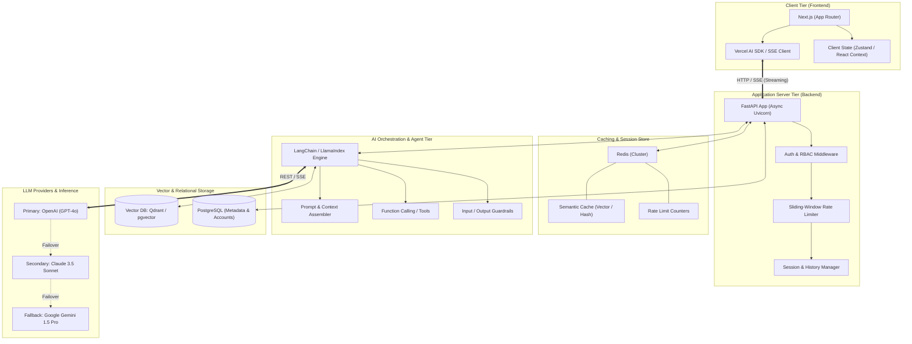
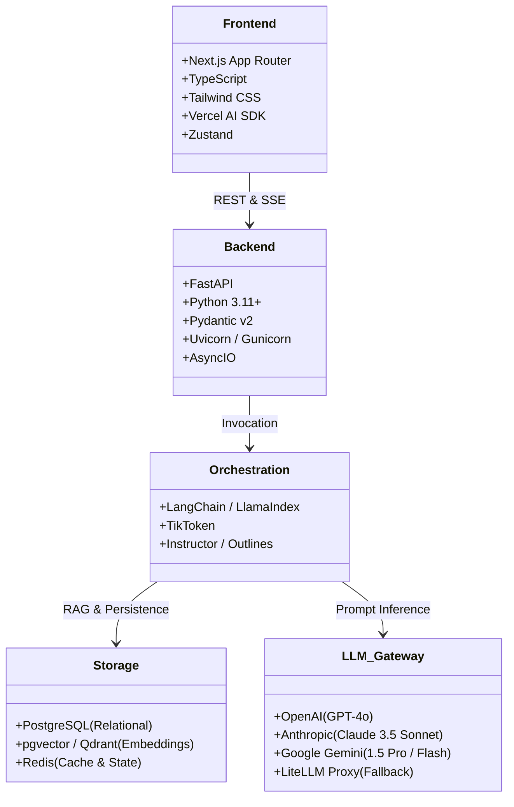
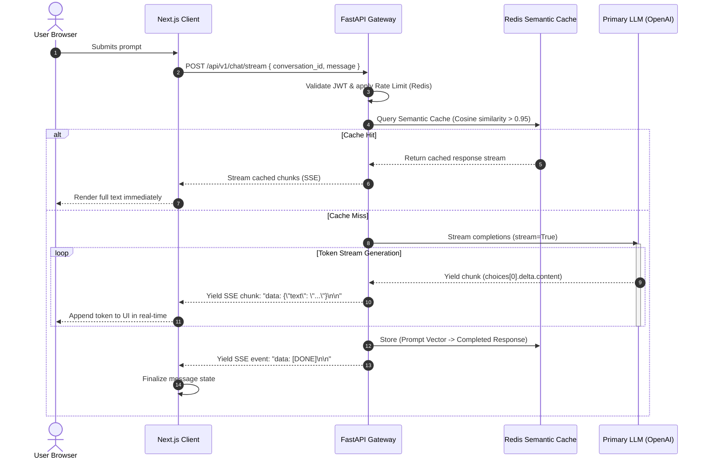
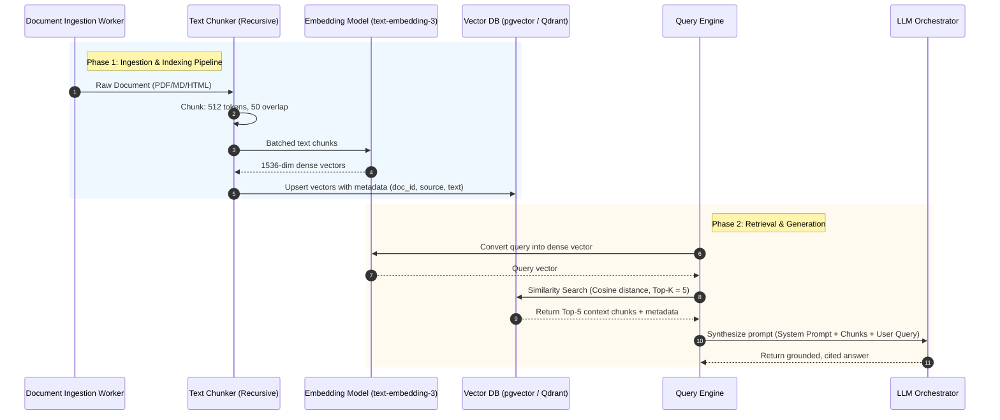
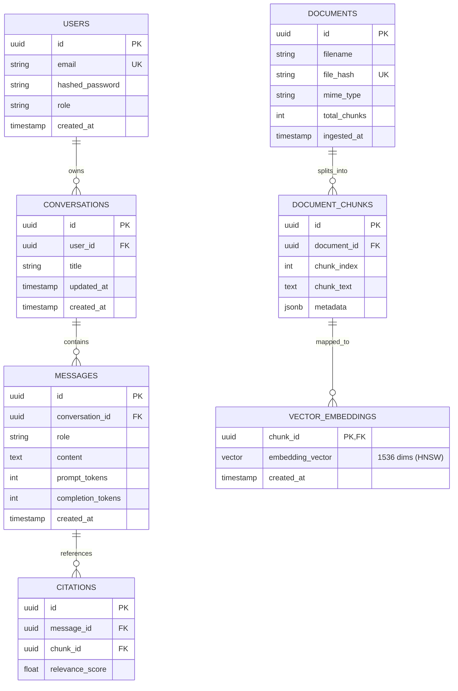
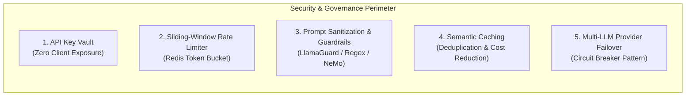
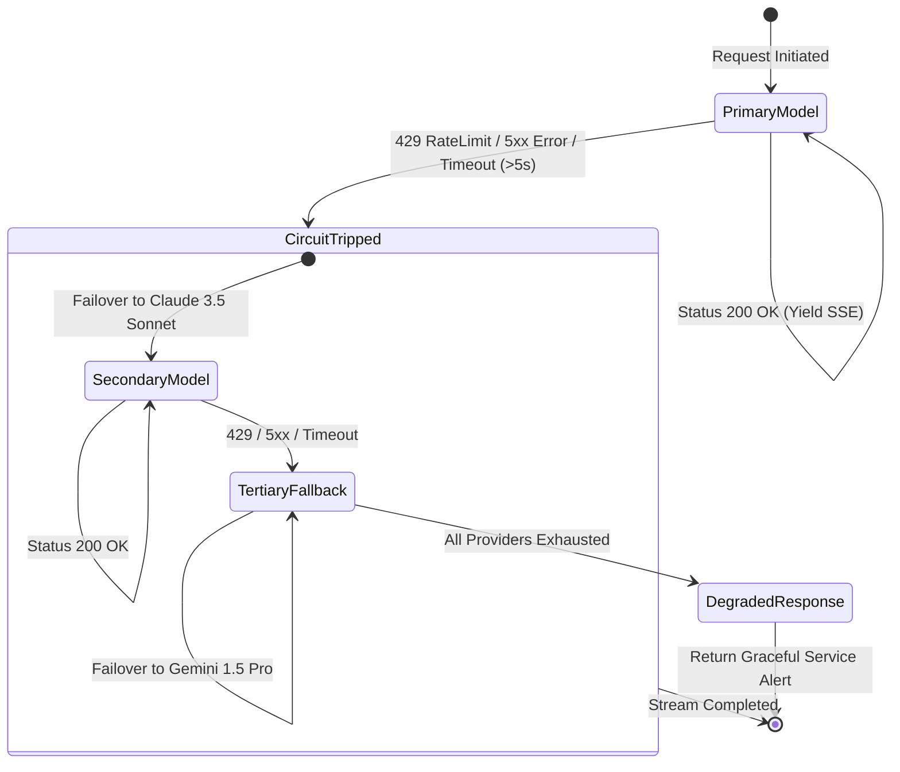
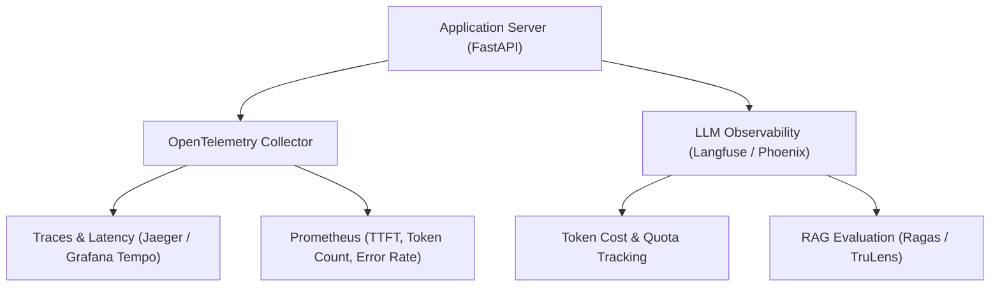
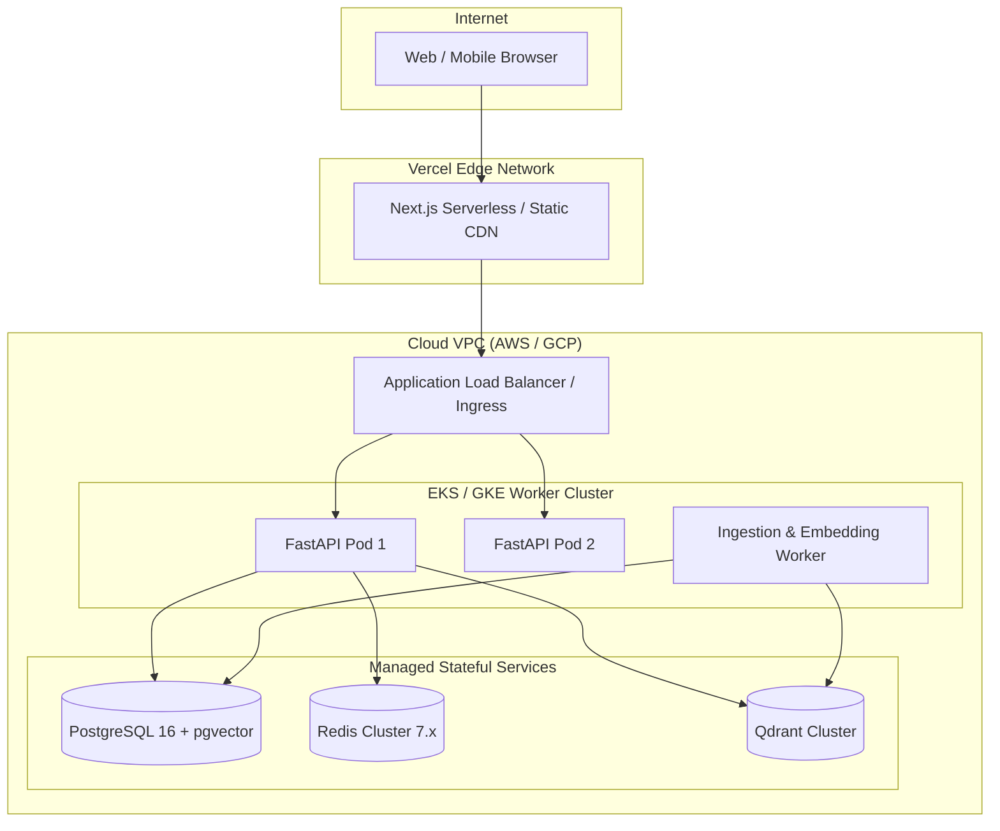

# System Design Document: AI Web Application Architecture

> **Document Version:** 1.0.0  
> **Status:** Approved / Architecture Baseline  
> **Source Reference:** [`ai_web_development_guide.md`](file:///c:/Users/Cho%20Lae%20Lae%20Yin/Downloads/aseanvisa.com/ai_web_development_guide.md)  
> **Target Platform:** Modern AI-Powered Web Application

---

## 1. Executive Summary & Design Objectives

This System Design Document (SDD) formalizes the architectural blueprint and engineering specifications for a production-grade, AI-driven web application. Grounded in the principles and patterns defined in [`ai_web_development_guide.md`](file:///c:/Users/Cho%20Lae%20Lae%20Yin/Downloads/aseanvisa.com/ai_web_development_guide.md), this design decouples compute-intensive inference, semantic vector search, and API orchestration from high-performance edge-rendered client interfaces.

### Core Design Goals
1. **Low Latency & High Responsiveness:** Minimize Time to First Token (TTFT < 800ms) through asynchronous Server-Sent Events (SSE) streaming.
2. **Contextual Grounding (RAG):** Eliminate hallucinations via deterministic similarity retrieval using pgvector / Qdrant vector storage.
3. **Resilience & Cost Optimization:** Mitigate provider outages with multi-tier LLM failovers and reduce inference costs by 30–50% using semantic caching in Redis.
4. **Zero-Trust Security:** Safeguard API credentials, enforce sliding-window rate limiting, and protect against prompt injection and denial-of-wallet vectors.
5. **Horizontal Scalability:** Stateless backend services enabling independent scaling of API workers, vector databases, and client edge nodes.

---

## 2. High-Level System Architecture

The application adopts a decoupled 5-tier architecture that isolates the user interface, routing logic, orchestration engine, vector knowledge base, and foundation model providers.



### Layer Responsibilities

| Tier | Component | Core Responsibilities |
| :--- | :--- | :--- |
| **Client Tier** | Next.js (App Router) | Server-Side Rendering (SSR), edge routing, real-time SSE stream consumption, multimodal input processing (documents, images, audio), and optimistic UI updates. |
| **API Tier** | FastAPI (Python 3.11+) | JWT authentication, RBAC, sliding-window rate limiting, conversation session management, and asynchronous stream forwarding. |
| **Cache & Session** | Redis 7+ | Semantic response caching (vector similarity), token bucket rate limiting counters, and short-term session buffer. |
| **Orchestration** | LangChain / LlamaIndex | Dynamic prompt construction, RAG pipeline execution, tool/function dispatching, and guardrail validation. |
| **Vector Storage** | pgvector / Qdrant | Storage of document embeddings, HNSW index management, cosine similarity retrieval, and metadata filtering. |
| **Inference Gateway** | OpenAI / Anthropic / Gemini | Text and multimodal generation, structured output extraction, and multi-provider fallback resilience. |

---

## 3. Technology Stack Specification



### Justification & Trade-off Analysis

1. **Frontend: Next.js (App Router) with Vercel AI SDK**
   * *Rationale:* React Server Components (RSC) drastically reduce client bundle sizes. The Vercel AI SDK (`useChat`, `StreamingTextResponse`) provides battle-tested hooks for handling chunked streaming, auto-scroll, backpressure, and abort controllers natively.
2. **Backend: FastAPI (Python)**
   * *Rationale:* Native asynchronous `async/await` handling allows high-concurrency SSE connections with low memory footprints. Deep compatibility with Python AI/ML libraries (NumPy, LangChain, PyTorch, LlamaIndex) avoids IPC overhead.
3. **Vector Database: Dual-Engine Strategy (pgvector + Qdrant)**
   * *`pgvector` (Development & Structured Hybrid RAG):* Single PostgreSQL instance manages transactional data, user accounts, and embeddings. Reduces operational complexity.
   * *`Qdrant` (Scale & High Throughput):* Recommended for production vector workloads exceeding 1M vectors with dedicated HNSW index caching and sub-10ms filtered vector searches.
4. **Inference Orchestration: LangChain / LlamaIndex with LiteLLM**
   * *Rationale:* Standardizes vendor-agnostic chat completions, structured tool execution, and automatic retries/fallbacks across multiple model providers.
5. **Memory & Caching: Redis Cluster**
   * *Rationale:* In-memory sub-millisecond lookups for semantic prompt-response caching and distributed rate limiting across stateless FastAPI worker replicas.

---

## 4. Key Implementation Patterns & Workflows

### Pattern 1: High-Performance SSE Streaming Pipeline

Streaming LLM output eliminates perceived generation latency by transmitting tokens over an open HTTP connection using Server-Sent Events (`text/event-stream`).



#### FastAPI Streaming Implementation Specification
```python
# backend/api/v1/endpoints/chat.py
from fastapi import APIRouter, Depends, HTTPException, status
from fastapi.responses import StreamingResponse
from pydantic import BaseModel, Field
import json
import asyncio
from typing import AsyncGenerator
from services.llm_service import LLMService
from core.security import get_current_user

router = APIRouter(prefix="/chat", tags=["Chat"])

class ChatRequest(BaseModel):
    conversation_id: str = Field(..., description="UUID of the active conversation")
    message: str = Field(..., min_length=1, max_length=4000)

async def stream_generator(prompt: str, user_id: str) -> AsyncGenerator[str, None]:
    llm_service = LLMService()
    try:
        async for chunk in llm_service.stream_response(prompt=prompt, user_id=user_id):
            payload = json.dumps({"content": chunk, "status": "generating"})
            yield f"data: {payload}\n\n"
        yield "data: [DONE]\n\n"
    except Exception as exc:
        error_payload = json.dumps({"error": str(exc), "status": "failed"})
        yield f"data: {error_payload}\n\n"

@router.post("/stream")
async def chat_stream_endpoint(
    request: ChatRequest,
    current_user: dict = Depends(get_current_user)
):
    return StreamingResponse(
        stream_generator(request.message, current_user["id"]),
        media_type="text/event-stream",
        headers={
            "Cache-Control": "no-cache",
            "Connection": "keep-alive",
            "X-Accel-Buffering": "no"  # Prevents NGINX from buffering SSE chunks
        }
    )
```

---

### Pattern 2: Retrieval-Augmented Generation (RAG) Architecture

Grounds user conversations with domain-specific knowledge bases, documents, and reference materials.



#### RAG Chunking & Retrieval Configurations

* **Chunking Algorithm:** Recursive Character Splitting with syntactic separators `["\n\n", "\n", ". ", " ", ""]`.
* **Chunk Parameters:** 
  * Target size: `512` tokens (`~2000` characters).
  * Overlap: `50` tokens (`~200` characters) to preserve contextual boundaries.
* **Embedding Model:** `text-embedding-3-small` (1536 dimensions) for cost efficiency; `text-embedding-3-large` (3072 dimensions) for high-accuracy legal/technical requirements.
* **Retrieval Metric:** Cosine Similarity with an empirical cutoff threshold of $S_{\text{sim}} \ge 0.78$.
* **Re-ranking (Optional Phase):** Cohere Rerank v3 applied to the Top-20 retrieved candidates, truncating to Top-5 before prompt insertion.

#### Prompt Engineering & Context Injection Blueprint
```text
============================== SYSTEM PROMPT ==============================
You are a domain-expert AI assistant. Your responses must be strictly 
factual, objective, and grounded exclusively in the provided Reference 
Context below. 

Instructions:
1. If the context does not contain sufficient information to answer the question, 
   state: "I do not have sufficient information in the knowledge base to answer this."
2. Do not speculate or extrapolate beyond the provided text.
3. Cite the source document ID or section tag when providing specific facts.

Reference Context:
---------------------------------------------------------------------------
{retrieved_context_chunks}
---------------------------------------------------------------------------

=============================== USER PROMPT ===============================
User Query: {user_query}
```

---

## 5. Data Architecture & Database Schema

The persistence layer uses a hybrid design: relational storage for user profiles and conversation history, coupled with vector storage for indexed knowledge bases.



### PostgreSQL + pgvector Migration Schema
```sql
-- Enable pgvector extension
CREATE EXTENSION IF NOT EXISTS vector;
CREATE EXTENSION IF NOT EXISTS "uuid-ossp";

-- Document Chunks Table with Vector Column
CREATE TABLE document_chunks (
    id UUID PRIMARY KEY DEFAULT uuid_generate_v4(),
    document_id UUID NOT NULL REFERENCES documents(id) ON DELETE CASCADE,
    chunk_index INT NOT NULL,
    chunk_text TEXT NOT NULL,
    metadata JSONB DEFAULT '{}'::jsonb,
    embedding VECTOR(1536),
    created_at TIMESTAMPTZ DEFAULT NOW()
);

-- Fast Approximate Nearest Neighbor Index (HNSW)
CREATE INDEX idx_document_chunks_hnsw_cosine 
ON document_chunks 
USING hnsw (embedding vector_cosine_ops)
WITH (m = 16, ef_construction = 64);
```

---

## 6. Security, Governance & Production Checklist

Implementing the production checklist defined in [`ai_web_development_guide.md`](file:///c:/Users/Cho Lae Lae Yin/Downloads/aseanvisa.com/ai_web_development_guide.md):



### 1. API Key Protection & Zero-Trust Architecture
* **Rule:** Vendor API keys (`OPENAI_API_KEY`, `ANTHROPIC_API_KEY`, `GEMINI_API_KEY`) are exclusively stored in server-side environment variables or cloud secrets managers (AWS Secrets Manager, GCP Secret Manager).
* **Client Boundaries:** Next.js client bundles are scanned via automated CI pipelines (`trufflehog`, `git-secrets`) to ensure no `NEXT_PUBLIC_*` variable exposes an inference secret.

### 2. Multi-Tier Rate Limiting Architecture
* **Algorithm:** Redis-backed Sliding Window Log or Token Bucket.
* **Tiering Policy:**
  * Anonymous Users: 5 requests / minute, 50 requests / day.
  * Authenticated (Standard Tier): 30 requests / minute, 500 requests / day.
  * Enterprise Tier: 120 requests / minute, customized token ceilings.
* **Defense against Denial-of-Wallet:** Enforce max token output boundaries (`max_tokens=1500`) and input character limits (`max_length=4000`) on all user prompts.

### 3. Prompt Injection & Jailbreak Defense
* **Input Sanitization:** Strip control characters, escape backticks and system delimiter markers (`---`, `===`).
* **Delimiter Defense:** Wrap dynamic user input within explicit boundary tags:
  ```text
  <user_untrusted_input>
  {user_sanitized_input}
  </user_untrusted_input>
  ```
* **Guardrail Enforcement:** Pipe prompts through lightweight classifier models (e.g., Llama-Guard-3 or regex policy engine) prior to invoking expensive frontier models.

### 4. Semantic Response Caching
* **Mechanism:** Generate vector embeddings for incoming user queries. Query Redis Vector Similarity Index with a similarity threshold of $\ge 0.96$.
* **Hit Evaluation:** If matched, return the cached completion immediately, bypassing LLM invocation entirely (reducing latency to $< 20\text{ms}$ and cost to $\$0.00$).

### 5. Multi-Provider Fallback & Circuit Breaker Workflow



---

## 7. API Specification & Interface Contracts

### 1. Real-Time Chat Completion Stream
* **Endpoint:** `POST /api/v1/chat/stream`
* **Content-Type:** `application/json`
* **Accept:** `text/event-stream`

#### Request Payload
```json
{
  "conversation_id": "c7a8b9d0-1234-5678-9abc-def012345678",
  "message": "What are the latest requirements for digital nomad visas?",
  "stream": true,
  "temperature": 0.2
}
```

#### SSE Stream Events Protocol
```http
HTTP/1.1 200 OK
Content-Type: text/event-stream
Cache-Control: no-cache
Connection: keep-alive

data: {"type": "metadata", "model": "gpt-4o", "cache_hit": false}

data: {"type": "token", "content": "Digital"}

data: {"type": "token", "content": " nomad"}

data: {"type": "token", "content": " visas"}

data: {"type": "citation", "source": "immigration_policy_2026.pdf", "chunk_id": "9a1f-..."}

data: [DONE]
```

### 2. Knowledge Ingestion Endpoint
* **Endpoint:** `POST /api/v1/documents/ingest`
* **Content-Type:** `multipart/form-data`

#### Response Payload
```json
{
  "document_id": "d1e2f3a4-5678-90ab-cdef-1234567890ab",
  "filename": "guidelines_v2.pdf",
  "status": "indexed",
  "chunks_created": 34,
  "embedding_model": "text-embedding-3-small",
  "duration_ms": 1240
}
```

---

## 8. Observability, Telemetry & Quality Evaluation



### Key Performance Indicators (KPIs)
1. **Time to First Token (TTFT):** Target $\le 800\text{ms}$ (P95).
2. **End-to-End Generation Time:** Target $\le 3500\text{ms}$ for 300 tokens.
3. **Cache Hit Ratio (Semantic):** Target $\ge 25\%$ on frequently asked queries.
4. **Context Faithfulness (RAGAS Score):** Target $\ge 0.92$ (minimizing hallucination).
5. **Circuit Breaker Recovery:** Auto-reset probe every 30 seconds following outage resolution.

---

## 9. Infrastructure & Deployment Topology



### Deployment Strategy
* **Frontend:** Deployed to Vercel or Cloudflare Pages with edge SSR and global asset distribution.
* **Backend:** Dockerized multi-stage container deployment running under Gunicorn with Uvicorn worker classes on Kubernetes (GKE/EKS) or Google Cloud Run.
* **Continuous Integration:** GitHub Actions / GitLab CI executing:
  1. Static type checking (`mypy`, `tsc --noEmit`).
  2. Linter suites (`ruff`, `eslint`).
  3. Unit and RAG regression tests (mock LLM evaluations with deterministic assertions).
  4. Docker container build and vulnerability scanning (`trivy`).

---

## 10. Traceability Matrix

This table maps the core guidelines from [`ai_web_development_guide.md`](file:///c:/Users/Cho Lae Lae Yin/Downloads/aseanvisa.com/ai_web_development_guide.md) directly to their architecture implementations in this document:

| Source Guide Section | Architecture Implementation in `design.md` | Verification & Testing Method |
| :--- | :--- | :--- |
| **1. System Architecture** | Decoupled 5-Tier Architecture (`Section 2`) | Component isolation verification, mock integration tests. |
| **2. Recommended Stack** | Next.js App Router, FastAPI, pgvector/Qdrant, Redis, LangChain (`Section 3`) | Dockerized composition build and dependency compatibility tests. |
| **3. Pattern A: Streaming (SSE)** | Asynchronous `StreamingResponse` with SSE protocol (`Section 4, Pattern 1`) | Latency benchmark verifying TTFT $< 800\text{ms}$. |
| **3. Pattern B: RAG Pipeline** | Recursive 512-token chunking, cosine retrieval, and context injection (`Section 4, Pattern 2`) | Ragas faithfulness and citation accuracy verification. |
| **4. API Key Protection** | Zero-trust vault storage and client-side isolation (`Section 6.1`) | Automated secret scanning in CI/CD pipeline. |
| **4. Rate Limiting** | Redis sliding-window token bucket per IP/User (`Section 6.2`) | Stress test simulating 500 concurrent burst requests. |
| **4. Prompt Injection Defense** | Input sanitization, delimiters, and guardrail layer (`Section 6.3`) | Red-teaming and injection attack test suite. |
| **4. Semantic Caching** | Vector similarity cache in Redis ($\ge 0.96$ threshold) (`Section 6.4`) | Cache hit latency and freshness invalidation tests. |
| **4. Fallback Models** | Automated circuit-breaker failover: OpenAI $\rightarrow$ Claude $\rightarrow$ Gemini (`Section 6.5`) | Chaos engineering simulating 500 error on primary API. |

---

## 11. Product UI Theme Redesign

### Objective

Reposition the interface as a trustworthy ASEAN travel and visa concierge. The current dark, telemetry-heavy styling emphasizes AI infrastructure more than the visitor's primary needs: choosing a destination, understanding visa options, and getting clear, source-grounded guidance.

### Visual Direction

- **Overall feel:** Welcoming, calm, travel-oriented, and credible—closer to a regional travel advisory service than a developer operations dashboard.
- **Core palette:** Warm ivory and soft sand for the page and surfaces; deep rainforest green for primary actions and navigation states; restrained brass or terracotta accents for highlights.
- **Contrast and legibility:** Use dark, high-contrast text on light surfaces for long-form visa guidance, with clear borders and focus states.
- **Visual cues:** Use subtle passport-stamp, itinerary, and official-document motifs in cards and section details. Keep decoration restrained so it does not compete with requirements or citations.
- **Typography:** Retain the existing readable sans-serif family unless implementation testing identifies a concrete usability issue; prioritize hierarchy and comfortable reading over technical ornament.

### Planned Interface Changes

1. **Establish a travel-first hierarchy.** Make destination selection and visa inquiry the most prominent parts of the experience. Present the assistant as a practical visa guide rather than an “intelligence engine.”
2. **Make country destinations feel central.** Restyle the ASEAN country list as a clear destination navigator, with an easily recognized active state and readable visa-category summaries.
3. **Reframe the welcome experience.** Replace infrastructure-led introductory copy and feature emphasis with a concise explanation of supported visa guidance, country coverage, and how to ask a useful question. Keep the existing suggested inquiries, but style them as practical travel prompts.
4. **Present guidance as a readable service conversation.** Use calm light message surfaces, clear distinction between visitor questions and advisor replies, and prominent, easy-to-follow source citations.
5. **Keep technical controls secondary.** Retain the architecture and telemetry inspector, model selection, RAG context, ingestion, settings, and security information for users who need them. Style these as supporting or advanced tools so they do not dominate the primary visa-advice flow.
6. **Use one consistent visual system.** Update shared CSS tokens and apply them across the header, navigation, buttons, chat, cards, context drawer, inspector, and modals; avoid leaving isolated dark-dashboard surfaces behind.
7. **Preserve responsive and accessible behavior.** Keep existing interactions and responsive layouts, with visible keyboard focus, sufficient contrast, and touch-friendly controls.

### Implementation Notes

- **`styles.css`:** Replace the current dark blue palette with semantic light-surface, rainforest-green, and warm-accent tokens. Apply those tokens consistently to page backgrounds, text, borders, controls, message cards, status displays, dialogs, and responsive states.
- **`index.html`:** Update user-facing labels and welcome copy where they currently foreground architecture over visa assistance. Preserve element IDs, form controls, data attributes, and button behavior used by `app.js`.
- **`app.js`:** No behavioral changes are planned. Update only if required to keep existing interactions working with revised markup; avoid changing visa guidance, retrieval, or telemetry behavior as part of the visual redesign.

### Acceptance Criteria

- The first impression communicates ASEAN destinations and practical visa help, not an AI operations console.
- The warm neutral, rainforest-green, and restrained warm-accent palette is consistent across the complete page, including advanced panels and modals.
- Destination selection, inquiry entry, assistant replies, and citations remain clear and easy to use.
- Existing chat, country selection, settings, telemetry, ingestion, and responsive interactions continue to work.
- Text and controls remain legible, keyboard-operable, and visibly focused on desktop and mobile layouts.

**Status:** Implemented. The primary interface now uses the travel-first palette and messaging, with architecture telemetry available as a secondary drawer.
